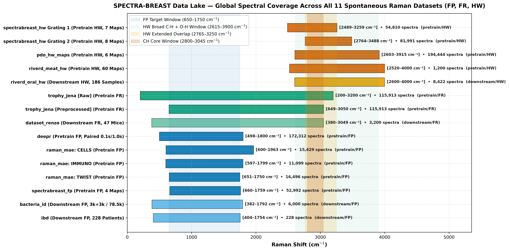
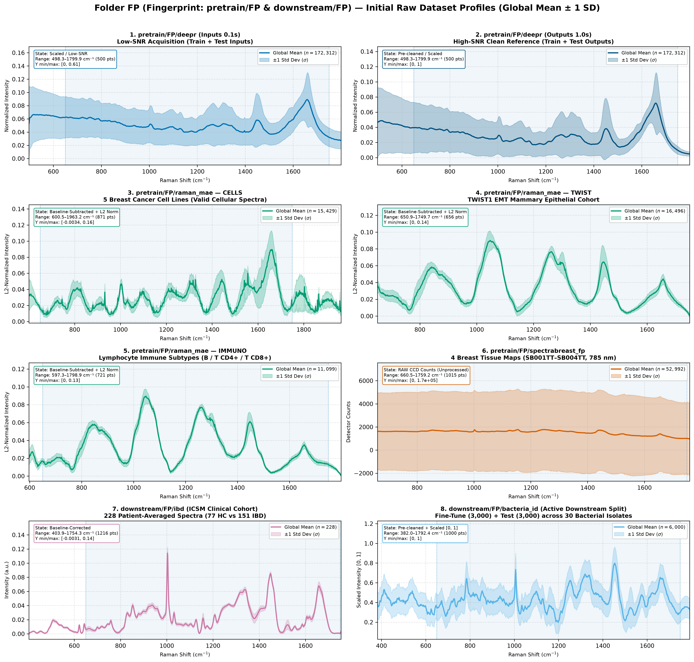
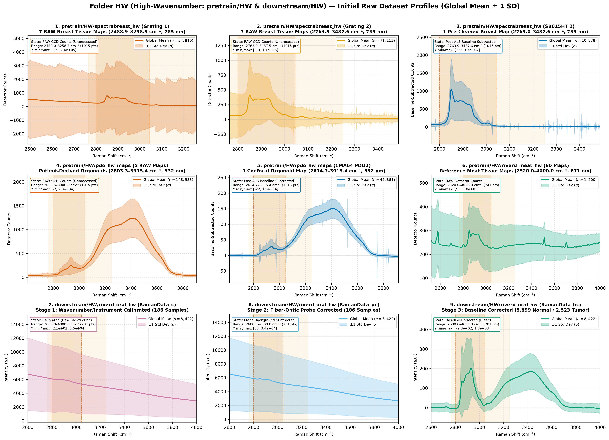
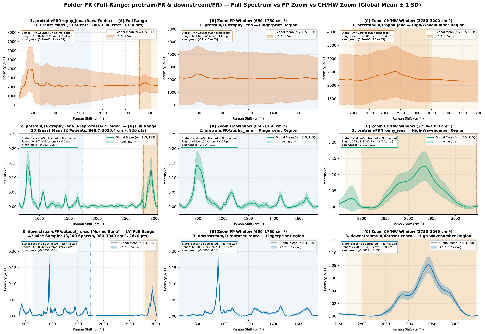

# SPECTRA-BREAST — Step 1: Master Raw Datasets Overview (`FP`, `HW`, `FR`)

> **Document Scope:** Complete technical inventory, directory taxonomy, physical state verification, and global spectral profile atlas ($\mu \pm 1\sigma$ computed across 100% of valid spectra) for all **11 Spontaneous Raman datasets** stored in `data/00_raw/` (all SERS datasets have been removed to maintain strict modality homogeneity).
> **Companion Notebook:** [`notebooks/01_raw_datasets_atlas.ipynb`](../notebooks/01_raw_datasets_atlas.ipynb)

---

## 1. Executive Summary & Directory Architecture

To support both **Self-Supervised Pre-Training** (`SMAE` 1D-ViT and `Barlow Twins` 1D-ResNet-34) and **Downstream Clinical Validation / Fine-Tuning**, the raw data lake (`data/00_raw/`) is organized symmetrically along two orthogonal axes:

1. **Experimental Role (`pretrain/` vs `downstream/`)**:
   - **`pretrain/` (7 Datasets — `716,686` valid spectra)**: Unlabeled cohorts (`deepr`, `raman_mae`, `riverd_meat_hw`), weak map-level cohorts without pixel-level ground truth masks (`spectrabreast_fp`, `spectrabreast_hw`, `pdo_hw_maps`), or multi-map cohorts with only 2 patients (`trophy_jena`, where supervised classification would suffer from patient-level data leakage).
   - **`downstream/` (4 Datasets — `17,850` active validation/fine-tuning spectra)**: Strictly separated cohorts equipped with verified spectrum-level and patient/sample-level labels across multiple independent subjects/cohorts for rigorous Out-of-Distribution (OOD) validation (`ibd`, `bacteria_id`, `riverd_oral_hw`, `dataset_renzo`).
2. **Spectral Region (`FP/`, `HW/`, `FR/`)**:
   - **`FP/` (Fingerprint Region, `~382 – 1963` $\text{cm}^{-1}$)**: Captures fundamental skeletal vibrations of proteins (Amide I/III, Phenylalanine), nucleic acids, lipids, and carbohydrates. Target standardized window: **`[650, 1750]` $\text{cm}^{-1}$**.
   - **`HW/` (High-Wavenumber Region, `~2488 – 4000` $\text{cm}^{-1}$)**: Captures aliphatic and olefinic $\text{C–H}$ stretching vibrations of lipids and proteins (`~2800 – 3050` $\text{cm}^{-1}$) together with the $\text{O–H}$ stretching band of tissue water (`~3100 – 3700` $\text{cm}^{-1}$).
   - **`FR/` (Full-Range Region, `~200/380 – 3050/3200` $\text{cm}^{-1}$)**: Wideband acquisitions spanning simultaneously across the Fingerprint (`FP`), silent region (`1800 – 2700` $\text{cm}^{-1}$), and $\text{C–H}$ / High-Wavenumber (`CH/HW`) regions.

```text
data/00_raw/
├── pretrain/                           # 7 Datasets (716,686 valid spectra — 0% overlap with downstream)
│   ├── FP/
│   │   ├── deepr/                      # 172,312 paired spectra (498.3 - 1799.9 cm⁻¹, 500 pts)
│   │   ├── raman_mae/                  # 43,024 valid spectra across CELLS (15,429), TWIST (16,496), IMMUNO (11,099)
│   │   └── spectrabreast_fp/           # 52,992 spectra from 4 breast maps (660.2 - 1759.4 cm⁻¹, 1015 pts)
│   ├── HW/
│   │   ├── spectrabreast_hw/           # 136,801 spectra from 15 breast maps (2488.9 - 3487.6 cm⁻¹, 1015 pts)
│   │   ├── pdo_hw_maps/                # 194,444 spectra from 6 organoid maps (2603.3 - 3915.4 cm⁻¹, 1015 pts)
│   │   └── riverd_meat_hw/             # 1,200 spectra from 60 meat maps (2520.0 - 4000.0 cm⁻¹, 741 pts)
│   └── FR/
│       └── trophy_jena/                # 115,913 valid spectra from 10 breast maps (Raw: 200-3200 | Prep: 648.7-3050.4 cm⁻¹)
│
└── downstream/                         # 4 Datasets (17,850 active validation/fine-tuning spectra)
    ├── FP/
    │   ├── ibd/                        # 228 patient-averaged spectra (403.9 - 1754.3 cm⁻¹, 1216 pts)
    │   └── bacteria_id/                # 6,000 active downstream spectra (3k finetune + 3k test; 78.5k total, 382.0 - 1792.4 cm⁻¹)
    ├── HW/
    │   └── riverd_oral_hw/             # 8,422 spectra from 186 oral resection samples (2600.0 - 4000.0 cm⁻¹, 701 pts)
    └── FR/
        └── dataset_renzo/              # 3,200 spectra from 47 murine bone samples (380.0 - 3049.0 cm⁻¹, 2670 pts)
```

---

## 2. Master Inventory & Physical State Table

| Folder | Dataset Name | Modality | Files / Subjects | Total Raw Spectra | Valid Active Spectra | Wavenumber Range ($\text{cm}^{-1}$) | Pts ($N$) | Step ($\Delta\tilde{\nu}$) | Initial State in `00_raw` | Label Granularity & Classes | Assigned Project Role |
| :--- | :--- | :--- | :--- | ---: | ---: | :--- | ---: | ---: | :--- | :--- | :--- |
| **`pretrain/FP`** | `deepr` | Spontaneous Raman | 4 `.mat` (`Train`/`Test` `In`/`Out`) | 172,312 | **172,312** | `498.26 – 1799.90` | 500 | 2.61 | Paired Low-SNR (`0.1s`) & Clean (`1.0s`), scaled | Unlabeled (Denoising pairs) | **SSL Pre-Train** (`FP` & `Barlow Twins`) |
| **`pretrain/FP`** | `raman_mae (CELLS)` | Spontaneous Raman (785nm) | 1 `.mat` (5 Breast Cell Lines) | 23,530 | **15,429** | `600.46 – 1963.25` | 871 | 1.57 | Baseline-Subtracted + L2-Norm *(15,429 valid cell rows filtered)* | Cell line ID *(used unlabeled)* | **SSL Pre-Train** (`FP` & `Barlow Twins`) |
| **`pretrain/FP`** | `raman_mae (TWIST)` | Spontaneous Raman (785nm) | 1 `.mat` (EMT Mammary Cells) | 18,092 | **16,496** | `650.86 – 1749.70` | 656 | 1.68 | Baseline-Subtracted + L2-Norm *(1,596 zero rows filtered)* | Unlabeled | **SSL Pre-Train** (`FP` & `Barlow Twins`) |
| **`pretrain/FP`** | `raman_mae (IMMUNO)` | Spontaneous Raman (785nm) | 1 `.mat` (`B`, `T CD4+`, `T CD8+`) | 11,099 | **11,099** | `597.32 – 1798.91` | 721 | 1.67 | Baseline-Subtracted + L2-Norm | Immune subtype *(used unlabeled)* | **SSL Pre-Train** (`FP` & `Barlow Twins`) |
| **`pretrain/FP`** | `spectrabreast_fp` | Spontaneous Raman Maps (785nm) | 4 `.h5` Breast Maps (`SB001TT–004TT`) | 52,992 | **52,992** | `660.22 – 1759.36` | 1015 | 1.08 | **RAW CCD Counts** *(needs Despike + ALS + Resampling + MinMax)* | Weak map-level only (`TT`, no pixel masks) | **SSL Pre-Train** (`FP` & `Barlow Twins`) |
| **`pretrain/HW`** | `spectrabreast_hw` | Spontaneous Raman Maps (785nm) | 15 `.h5` Breast Maps | 136,801 | **136,801** | `2488.85 – 3487.65` *(Overlap: `2763.9–3258.8`)* | 1015 | 0.74 | **MIXED:** 14 Maps **RAW CCD Counts** (`125,923`) + 1 Map (`SB015HT 2`, `10,878`) **Post-ALS** | Weak map-level only (`HT` vs `TT`, no pixel masks) | **SSL Pre-Train** (`HW/CH` & `Barlow Twins`) |
| **`pretrain/HW`** | `pdo_hw_maps` | Spontaneous Raman Maps (532nm) | 6 `.h5` Organoid Maps | 194,444 | **194,444** | `2603.29 – 3915.42` *(Overlap: `2614.7–3906.2`)* | 1015 | 1.28 | **MIXED:** 5 Maps **RAW CCD Counts** (`146,583`) + 1 Map (`CMA64 PDO2`, `47,861`) **Post-ALS** | Single-class only (`Tumoral PDO`) | **SSL Pre-Train** (`HW/CH` & `Barlow Twins`) |
| **`pretrain/HW`** | `riverd_meat_hw` | Spontaneous Raman Maps (671nm) | 60 `.h5` Maps (`rxh1–rxh60`) | 1,200 | **1,200** | `2520.00 – 4000.00` | 741 | 2.00 | **RAW Detector Counts** *(needs Despike + ALS + Resampling + MinMax)* | Unlabeled | **SSL Pre-Train** (`HW/CH` & `Barlow Twins`) |
| **`pretrain/FR`** | `trophy_jena` | Spontaneous Raman Maps (785nm) | 10 `.mat` Maps (**Only 2 Patients**) | 144,000 | **115,913** | `Raw: 200.0–3200.0` `Prep: 648.68–3050.44` | 1024 / 820 | 2.93 | **Both folders provided:** `Raw/` (unprocessed) & `Preprocessed/` (cleaned) | Pixel-level `Area` (`Tumor`, `Muscle`, `Stroma`, `Vessel`), **2 patients only** | **SSL Pre-Train ONLY** (`FP`, `CH` & `Barlow Twins`) |
| **`downstream/FP`** | `ibd` | Spontaneous Raman (785nm) | 1 `.xlsx` (228 Patients, ICSM) | 228 | **228** | `403.89 – 1754.26` | 1216 | 1.11 | **Baseline-Corrected** *(averaged from 962 replicates)* | Patient-level: `77 HC` vs `151 IBD` (`Crohn`/`UC`) | **Downstream Validation** (`FP`) |
| **`downstream/FP`** | `bacteria_id` | Spontaneous Raman | 5 `.npy` splits (30 Isolates) | 78,500 | **6,000** *(active)* | `381.98 – 1792.40` | 1000 | 1.41 | **Pre-cleaned & Scaled in `[0, 1]`** | Spectrum-level: 30 classes (`3,000` finetune + `3,000` test; `60k` ref excluded) | **Downstream Validation** (`FP`) |
| **`downstream/HW`** | `riverd_oral_hw` | Fiber-Probe Raman | 4 `.xlsx` (186 Resection Samples, 4 Cohorts) | 8,422 | **8,422** | `2600.00 – 4000.00` | 701 | 2.00 | **3 Stages provided:** `c` (Calibrated), `pc` (Probe-Corr), `bc` (Baseline-Corr) | Sample & Spectrum-level: `5,899 Normal` (134 subj) vs `2,523 Tumor` (85 subj) | **PRIMARY Validation & Fine-Tuning (`HW / CH`)** |
| **`downstream/FR`** | `dataset_renzo` | Spontaneous Raman | 1 `.csv` (47 Murine Bone Samples) | 3,200 | **3,200** | `380.00 – 3049.00` | 2670 | 1.00 | **Baseline-Subtracted & Normalized** | Sample-grouped: `Bone` (3 classes: skull/femur/tibia) & `Pathology` (4 classes) | **SECONDARY Validation (`FP` & `CH 2800–3045`)** |

---

## 3. Global Spectral Coverage Across All 11 Spontaneous Raman Datasets

Figure 1 illustrates the exact wavenumber span ($\text{cm}^{-1}$) of every cohort in the data lake relative to the four standardized spectral windows:
1. **`FP Target Window` (`650 – 1750` $\text{cm}^{-1}$)**
2. **`CH Core Window` (`2800 – 3045` $\text{cm}^{-1}$)** — covered by **all** `HW` and `FR` datasets (`spectrabreast_hw`, `pdo_hw_maps`, `riverd_meat_hw`, `trophy_jena`, `riverd_oral_hw`, and `dataset_renzo`).
3. **`HW Extended Overlap` (`2765 – 3250` $\text{cm}^{-1}$)** — the maximum common overlap shared across **all 81 `.h5` `HW` maps** (`15` `spectrabreast_hw` + `6` `pdo_hw_maps` + `60` `riverd_meat_hw` = `332,445` spectra) **plus** `riverd_oral_hw` (`8,422` spectra).
4. **`HW Broad C–H + O–H Window` (`2615 – 3900` $\text{cm}^{-1}$)** — shared by `pdo_hw_maps` (`2615–3906` $\text{cm}^{-1}$), `riverd_meat_hw` (`2520–4000` $\text{cm}^{-1}$), and `riverd_oral_hw` (`2600–4000` $\text{cm}^{-1}$), capturing the complete $\text{C–H}$ and $\text{O–H}$ water bands.



---

## 3B. Mathematical Verification & Cross-Check Against Official Project Deliverables

| Dataset (`data/00_raw/...`) | Direct Array / File Check on Disk | Cross-Check Reference Source | Quantitative Y-Axis Proof (`[Min, Max]` & Norm) |
| :--- | :--- | :--- | :--- |
| **`spectrabreast_fp`** (`pretrain/FP`) | `4` `.h5` files (`SB001TT–SB004TT`), sum of `ny × nx` = **`52,992` spectra**, `1015` channels (`660.22–1759.36` $\text{cm}^{-1}$) | Matches `FAIRaman_spectral_count_summary.csv` (`fp_maps`: 4 files, **`52,992`** spectra) | `Y ∈ [0, 1.7e+05]` counts, positive baseline at `~1,600` counts $\rightarrow$ **Unprocessed RAW CCD Counts** |
| **`spectrabreast_hw`** (`pretrain/HW`) | `15` `.h5` files, sum of `ny × nx` = **`136,801` spectra**, `1015` channels (`2488.85–3487.65` $\text{cm}^{-1}$) | Matches `FAIRaman_spectral_count_summary.csv` (`Breast_Cancer_Tissue`: 15 files, **`136,801`** spectra) | 14 maps (`54,810` Grating 1 + `71,113` Grating 2 = `125,923`) are **RAW**; 1 map (`SB015HT 2`, `10,878`) sits at `0.0` (**Post-ALS**) |
| **`pdo_hw_maps`** (`pretrain/HW`) | `6` `.h5` files, sum of `ny × nx` = **`194,444` spectra**, `1015` channels (`2603.29–3915.42` $\text{cm}^{-1}$) | Matches `FAIRaman_spectral_count_summary.csv` (`PDO_Raman_Maps`: 6 files, **`194,444`** spectra) | 5 maps (`146,583` spectra) are **RAW**; 1 map (`CMA64 confocal PDO2`, `47,861` spectra) sits flat at `0.0` (**Post-ALS**) |
| **`riverd_meat_hw`** (`pretrain/HW`) | `60` `.h5` files (`rxh1–rxh60`, each `1 × 20` pixels) = **`1,200` spectra**, `741` channels (`2520.0–4000.0` $\text{cm}^{-1}$) | Matches `FAIRaman_spectral_count_summary.csv` (`Meat_sample`: 60 files, **`1,200`** spectra) | `Y ∈ [95, 780]` detector counts (strictly positive, flat fluorescence offset at `~240` counts) $\rightarrow$ **RAW Detector Counts** |
| **`deepr`** (`pretrain/FP`) | `Train_Inputs/Outputs` `(159618, 500)` + `Test_Inputs/Outputs` `(12694, 500)` = **`172,312` pairs**, `axis.txt` (`498.26–1799.90` $\text{cm}^{-1}$) | Matches `report_Datasets.pdf` & `Report_Pre_Training.pdf` (**`172,312`** spectra, 500 pts) | `Y ∈ [0.0, 1.0]` scaled; `Inputs` have higher variance ($\sigma$) from `0.1s` acquisition vs `1.0s` `Outputs` |
| **`raman_mae`** (`pretrain/FP`) | `CELLS`: `15,429` valid cell rows (`labels_table_status_cell1_bg0==1`); `TWIST`: `16,496` (`All_filt`); `IMMUNO`: `11,099` (`All_filt`) | Matches `report_Datasets.pdf` (`CELLS` **`15,429`**; `TWIST` **`16,496`**; `IMMUNO` **`11,099`** = **`43,024`** total) | Every valid row has Euclidean norm $\|\mathbf{x}\|_2 = \mathbf{1.0000 \pm 0.0000}$ and baseline at `0.0` $\rightarrow$ **Baseline-Subtracted + L2-Normalized** |
| **`trophy_jena`** (`pretrain/FR`) | `10` `.mat` maps of `(120, 120, C)` = `144,000` pixels; filtering `Pixelwise metadata.csv` (`fg_mask==1 & is_burnt==0`) yields **`115,913` spectra** | Matches `report_Datasets.pdf` & `deliverable 3.2.pdf` (**`115,913`** valid spectra across 2 patients `Paz 1`, `Paz 2`) | `Raw/` (`200–3200` $\text{cm}^{-1}$, 1024 pts) has `Y ∈ [370, 74000]` counts; `Preprocessed/` (`648.7–3050.4` $\text{cm}^{-1}$, 820 pts) has `Y ∈ [-0.09, 0.29]` |
| **`ibd`** (`downstream/FP`) | `Dataset Raman IBD Final ICSM.xlsx` (`Foglio2`) has shape `(228, 1227)`: `11` metadata cols + `1,216` wavenumber cols (`403.89–1754.26` $\text{cm}^{-1}$) across **`228` patients** | Matches `report_Datasets.pdf` (`228` patients: `77` HC vs `151` IBD, patient-averaged from `962` technical acquisitions) | `Y ∈ [-0.0031, 0.14]` with flat zero baseline $\rightarrow$ **Baseline-Corrected & Normalized** |
| **`bacteria_id`** (`downstream/FP`) | `X_reference` `(60000, 1000)`, `X_finetune` `(3000, 1000)`, `X_test` `(3000, 1000)`, `X_2018/2019clinical` `(12500, 1000)` = `78,500` total (**`6,000` active** finetune+test) | Matches *Ho et al. (2019)* & `deliverable 3.2.pdf` (30 bacterial classes, 100 spectra/class in `X_finetune` and `X_test`) | Every spectrum has `min = 0.000` and `max = 1.000` $\rightarrow$ **Pre-cleaned & Min-Max `[0, 1]` Scaled** |
| **`riverd_oral_hw`** (`downstream/HW`) | `RamanData_c/pc/bc.xlsx` each have shape `(701, 8422)` (`701` wavenumbers `2600–4000` $\text{cm}^{-1}$ $\times$ **`8,422` spectra**) | Matches `DELIVERABLE 3.1` & RiverD `.docx` manual (`186` oral cavity resection samples, 4 sources: **`5,899` Normal vs `2,523` Tumor**) | `_c`: `[210, 35000]` (raw calibrated); `_pc`: `[53, 34000]` (probe subtracted); `_bc`: `[-230, 1600]` (baseline-subtracted) |
| **`dataset_renzo`** (`downstream/FR`) | `def_dataset_final.csv` has shape `(2677, 3201)`: 7 metadata rows + `2,670` wavenumber rows (`380–3049` $\text{cm}^{-1}$) across **`3,200` spectrum columns** (`47` mice) | Direct full-file verification (`1,720` skull, `920` femur, `560` tibia; `1,840` WT, `640` Rankl-ko, `560` oc/oc, `160` HSCT) | `Y ∈ [-0.0036, 0.20]` with flat zero baseline across both `FP` and `CH` $\rightarrow$ **Baseline-Subtracted & Normalized** |

---

## 4. Folder `FP` — Fingerprint Datasets (`pretrain/FP` & `downstream/FP`)

Figure 2 displays the **Global Mean ($\mu$) $\pm 1$ Standard Deviation ($\sigma$)** computed across **all valid spectra** for every cohort inside `data/00_raw/pretrain/FP/` and `data/00_raw/downstream/FP/`.



### Key Technical Observations for `FP`:
1. **`pretrain/FP/deepr` (Panels 1 & 2, $n = 172,312$ pairs, `498.3–1799.9` $\text{cm}^{-1}$)**:
   - Panel 1 (`Inputs 0.1s`) shows the wider variance band caused by shot noise at short integration times, while Panel 2 (`Outputs 1.0s`) shows the clean reference spectra.
2. **`pretrain/FP/raman_mae` (`CELLS` Panel 3, `TWIST` Panel 4, `IMMUNO` Panel 5, $n = 43,024$ valid spectra)**:
   - All three `.mat` cohorts are already **baseline-subtracted and L2-normalized** ($\|\mathbf{x}\|_2 = 1$).
   - In `CELLS`, filtering by `labels_table_status_cell1_bg0 == 1` isolates the exact **`15,429` valid cellular spectra** (excluding substrate background and `NaN` rows).
3. **`pretrain/FP/spectrabreast_fp` (Panel 6, $n = 52,992$ spectra across 4 maps `SB001TT–SB004TT`, `660.2–1759.4` $\text{cm}^{-1}$)**:
   - **Unprocessed `RAW CCD Detector Counts`**: Requires `Despike + ALS Baseline Subtraction + Resampling + Min-Max [0, 1]` in Step 2.
4. **`downstream/FP/ibd` (Panel 7, $n = 228$ patient spectra, `403.9–1754.3` $\text{cm}^{-1}$) & `downstream/FP/bacteria_id` (Panel 8, $n = 6,000$ active downstream spectra, `382.0–1792.4` $\text{cm}^{-1}$)**:
   - Serve as the two independent downstream benchmarks for `FP`.

---

## 5. Folder `HW` — High-Wavenumber Datasets (`pretrain/HW` & `downstream/HW`)

Figure 3 displays the **Global Mean ($\mu$) $\pm 1$ Standard Deviation ($\sigma$)** across all valid spectra for every cohort inside `data/00_raw/pretrain/HW/` and `data/00_raw/downstream/HW/`.



### Key Technical Observations & Spectral Windows for `HW`:
1. **Why `spectrabreast_hw` Defines the Two Grating Bounds (`2488.9–3258.9` vs `2763.9–3487.6` $\text{cm}^{-1}$)**:
   - **Grating Window 1 (`2488.9 – 3258.9` $\text{cm}^{-1}$, Panel 1)**: 7 maps (`54,810` spectra, all **unprocessed `RAW CCD Counts`**).
   - **Grating Window 2 (`2763.9 – 3487.6` $\text{cm}^{-1}$, Panels 2 & 3)**: 8 maps (`81,991` spectra total), consisting of 7 **unprocessed `RAW`** maps (`71,113` spectra, Panel 2) and 1 **Post-ALS** map (`SB015HT 2`, `10,878` spectra, Panel 3).
   - Because Grating 2 starts at `2763.91` $\text{cm}^{-1}$ and Grating 1 ends at `3258.78` $\text{cm}^{-1}$, their **exact common overlap across all 15 breast maps is `[2765, 3250]` $\text{cm}^{-1}$ (`hw_extended`)**.
2. **`pdo_hw_maps` (`2603.3–3915.4` $\text{cm}^{-1}$, Panels 4 & 5, $n = 194,444$) & `riverd_meat_hw` (`2520.0–4000.0` $\text{cm}^{-1}$, Panel 6, $n = 1,200$)**:
   - Both cohorts span the entire `hw_extended` (`2765–3250` $\text{cm}^{-1}$) and `hw_broad` (`2615–3900` $\text{cm}^{-1}$) regions, capturing both the $\text{C–H}$ lipid/protein band (`2800–3050` $\text{cm}^{-1}$) and the $\text{O–H}$ water band (`3100–3700` $\text{cm}^{-1}$).
3. **`downstream/HW/riverd_oral_hw` (`2600.0–4000.0` $\text{cm}^{-1}$, Panels 7, 8 & 9, $n = 8,422$ spectra across 186 samples)**:
   - Covers `2600–4000` $\text{cm}^{-1}$ across 4 independent clinical cohorts (`5,899` Normal vs `2,523` Tumor), making it 100% compatible with **`ch_core` (`2800–3045` $\text{cm}^{-1}$)**, **`hw_extended` (`2765–3250` $\text{cm}^{-1}$)**, and **`hw_broad` (`2615–3900` $\text{cm}^{-1}$)**!

---

## 6. Folder `FR` — Full-Range Datasets (`pretrain/FR` & `downstream/FR`)

Figure 4 presents a **three-column diagnostic view** for each Full-Range cohort: **(Column A) Full Acquired Spectrum**, **(Column B) Zoom on `FP` (`650–1750` $\text{cm}^{-1}$)**, and **(Column C) Zoom on `CH/HW` (`2750–3050+` $\text{cm}^{-1}$)**.



---

## 7. Complete Pre-Training vs Fine-Tuning Compatibility Matrix

| Model & Spectral Regime | Target Wavenumber Grid | Pre-Training Cohorts (`data/00_raw/pretrain/`) | Downstream Validation / Fine-Tuning Cohorts (`data/00_raw/downstream/`) |
| :--- | :--- | :--- | :--- |
| **`SMAE` & `Barlow Twins` — `FP` Model** | **`[650, 1750]` $\text{cm}^{-1}$** (`1,000` pts) | `deepr` (`172,312`) + `raman_mae` (`43,024`) + `spectrabreast_fp` (`52,992`) + `trophy_jena` (`115,913`) = **`384,241` spectra** | 1. **`ibd`** (`228` patients: `77` HC vs `151` IBD)<br>2. **`bacteria_id`** (`3,000` finetune + `3,000` test, 30 classes)<br>3. **`dataset_renzo` (`FP` crop)** (`3,200` spectra, 47 mice) |
| **`SMAE` & `Barlow Twins` — `CH Core` Model** | **`[2800, 3045]` $\text{cm}^{-1}$** (`500` / `1,000` pts) | `spectrabreast_hw` (`136,801`) + `pdo_hw_maps` (`194,444`) + `riverd_meat_hw` (`1,200`) + `trophy_jena` (`115,913`) = **`448,358` spectra** | 1. **`riverd_oral_hw` (`CH` crop)** (`8,422` spectra, 186 samples: Normal vs Tumor)<br>2. **`dataset_renzo` (`CH` crop)** (`3,200` spectra, 47 mice: 3 bones / 4 pathologies) |
| **`SMAE` & `Barlow Twins` — `HW Extended` Model** | **`[2765, 3250]` $\text{cm}^{-1}$** (`500` / `1,000` pts) | `spectrabreast_hw` (`136,801`) + `pdo_hw_maps` (`194,444`) + `riverd_meat_hw` (`1,200`) *(+ `trophy_jena Raw/` up to `3200`)* = **`332,445`–`448,358` spectra** | 1. **`riverd_oral_hw` (`HW Extended` crop)** (`8,422` spectra, 186 samples across 4 clinical cohorts: Normal vs Tumor) |
| **`Barlow Twins` — Global Multi-Region CNN** | **Native Window Resampled to `1,000` pts** | **ALL 7 Pre-Train Datasets (`FP` + `HW` + `FR`)** = **`716,686` valid spectra** | Can be fine-tuned and evaluated on **all 4 Downstream Benchmarks** (`riverd_oral_hw`, `dataset_renzo`, `ibd`, `bacteria_id`)! |
