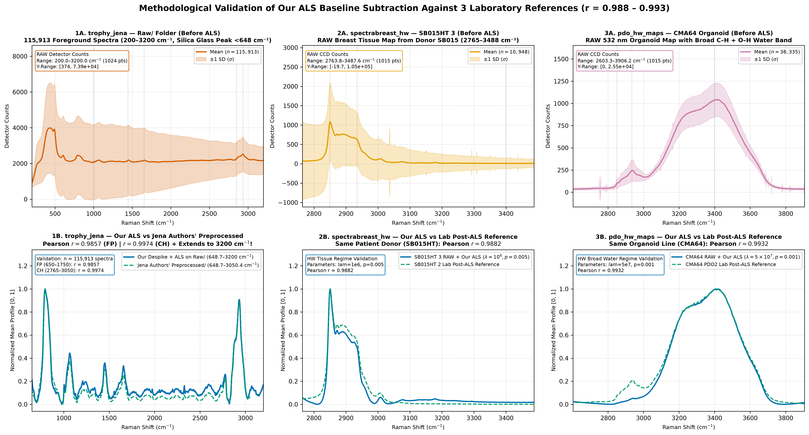
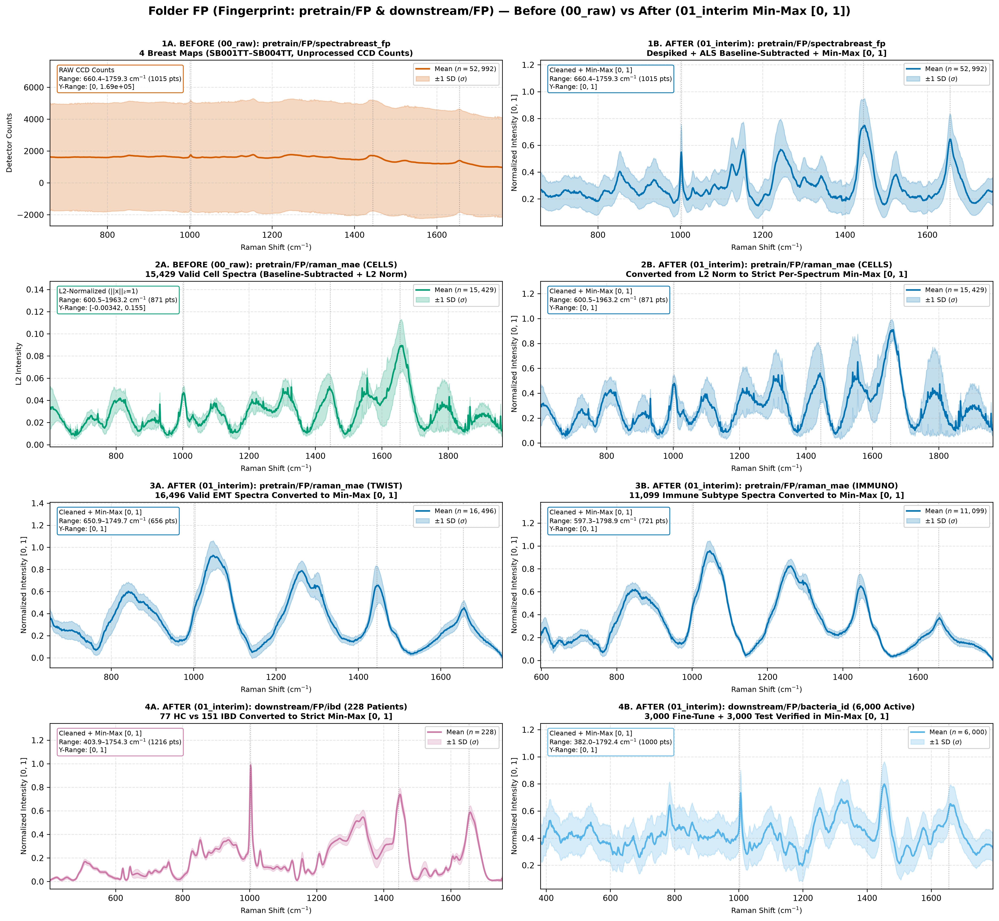
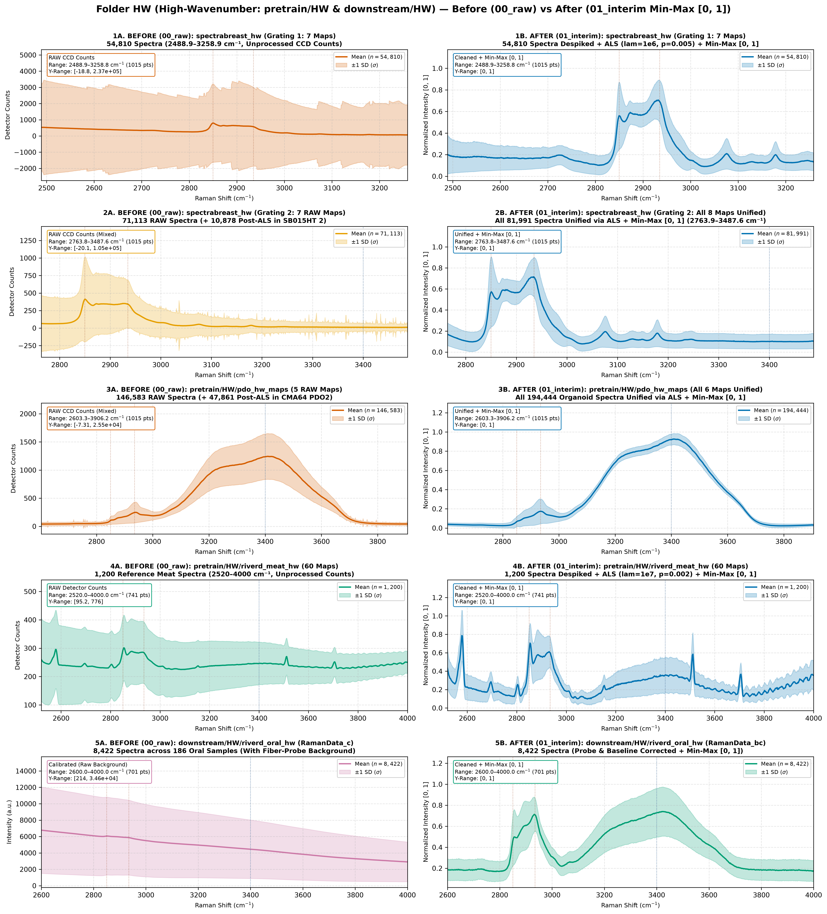
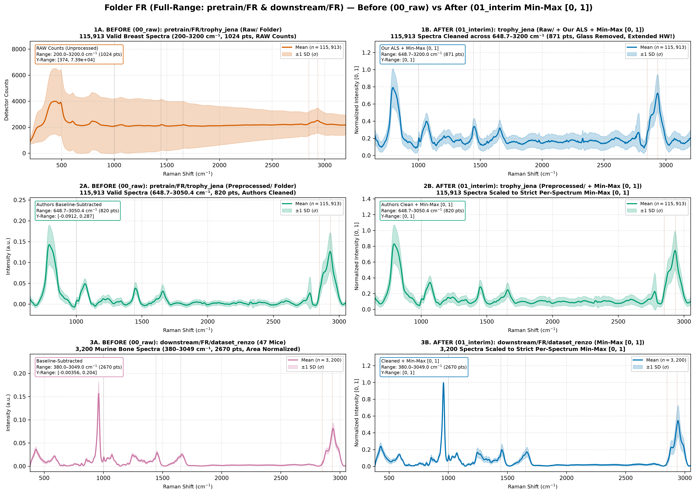

# SPECTRA-BREAST — Step 2: Native-Grid Cleaning & Single Min-Max `[0, 1]` Normalization (`00_raw` $\rightarrow$ `01_interim`)

> **Document Scope:** Complete methodological documentation, laboratory validation ($r = 0.988 - 0.997$), directory structure, and side-by-side **"Before (`00_raw`) vs After (`01_interim`)"** Global Mean ($\mu$) $\pm 1$ Standard Deviation ($\sigma$) profiles across all **11 Spontaneous Raman datasets** (`716,686` Pre-Training spectra + `17,850` Downstream Validation spectra).
> **Companion Notebook:** [`notebooks/02_preprocessing_before_after.ipynb`](../notebooks/02_preprocessing_before_after.ipynb)
> **Core Preprocessing Module:** [`src/spectrabreast/preprocessing/cleaning.py`](../src/spectrabreast/preprocessing/cleaning.py)

---

## 1. Architectural Rationale: Why Native-Grid Cleaning (`01_interim`) Precedes Cropping & Interpolation (`02_ready`)

In Raman spectroscopy foundation modeling, decoupling **Stage 2A (`01_interim`: Native-Grid Physical Cleaning & Single Min-Max `[0, 1]` Normalization)** from **Stage 2B (`02_ready`: Regional Cropping, Cubic Spline Interpolation to `1,000` points & Multi-Dataset Compilation)** resolves three critical physical and mathematical pitfalls:

1. **Zero Boundary Edge-Effects During ALS Baseline Subtraction**:
   - Asymmetric Least Squares (ALS, *Eilers & Boelens 2005*) estimates the smooth fluorescence envelope by minimizing:
     $$\mathcal{L}(\mathbf{z}) = \sum_{i=1}^{L} w_i (y_i - z_i)^2 + \lambda \sum_{i=2}^{L-1} (\Delta^2 z_i)^2, \qquad w_i = \begin{cases} p & \text{if } y_i > z_i \\ 1 - p & \text{if } y_i \le z_i \end{cases}$$
   - If a spectrum is cropped to a narrow window *before* ALS, the baseline loses its baseline anchor points in the flanking silent regions (e.g., `1750–1900` $\text{cm}^{-1}$ or `2500–2780` $\text{cm}^{-1}$ and `3750–4000` $\text{cm}^{-1}$), causing polynomial/spline edge distortion at the window boundaries. Performing ALS on the **full native axis** preserves all physical baseline anchors.
2. **Elimination of Redundant Double Normalization**:
   - Because Min-Max `[0, 1]` normalization ($\tilde{\mathbf{x}} = \frac{\mathbf{x} - \min(\mathbf{x})}{\max(\mathbf{x}) - \min(\mathbf{x})}$) is invariant to positive scalar multiplication, converting already baseline-subtracted L2-normalized cohorts (`raman_mae`, `SB001TT–SB004TT`) directly to Min-Max `[0, 1]` is mathematically identical to normalizing immediately after ALS, requiring **only a single normalization pass**.
3. **Preservation of Native Optical Resolution Across Different Architectures**:
   - Storing cleaned spectra on their native wavenumber grids in `data/01_interim/` allows Step 3 (`02_ready`) to construct both **deterministic fixed-window corpora for the `1D-ViT (SMAE)`** (`FP: 650–1750` $\text{cm}^{-1}$ and `HW/CH: 2765–3200/3250` or `2800–3045` $\text{cm}^{-1}$) and **the global multi-region `1,000`-point corpus for the `1D-ResNet-34 CNN (Barlow Twins)`** without ever re-running cosmic-ray despiking or ALS.

---

## 2. Mirror Directory Architecture in `data/01_interim/`

Every dataset in `data/01_interim/` mirrors the exact hierarchy of `data/00_raw/` (`pretrain/{FP,HW,FR}` and `downstream/{FP,HW,FR}`):

```text
data/01_interim/
├── pretrain/                           # 7 Datasets (716,686 valid spectra — Cleaned & Min-Max [0, 1] on Native Grid)
│   ├── FP/
│   │   ├── deepr/                      # deepr_interim.npz (172,312 pairs: 0.1s & 1.0s aligned in [0, 1], 500 pts)
│   │   ├── raman_mae/                  # cells_interim.npz (15,429), twist_interim.npz (16,496), immuno_interim.npz (11,099)
│   │   └── spectrabreast_fp/           # 4 .h5 maps (52,992 spectra: Despiked + ALS + Min-Max [0, 1], 1015 pts)
│   ├── HW/
│   │   ├── spectrabreast_hw/           # 15 .h5 maps (136,801 spectra unified in [0, 1]: 14 RAW cleaned + 1 Post-ALS)
│   │   ├── pdo_hw_maps/                # 6 .h5 maps (194,444 spectra unified in [0, 1]: 5 RAW cleaned + 1 Post-ALS)
│   │   └── riverd_meat_hw/             # 60 .h5 maps (1,200 spectra: Despiked + ALS + Min-Max [0, 1], 741 pts)
│   └── FR/
│       └── trophy_jena/                # BOTH trophy_preprocessed_minmax.npz (648.7–3050.4 cm⁻¹, 820 pts)
│                                       # AND trophy_raw_als_minmax.npz (648.7–3200.0 cm⁻¹, 871 pts, Our ALS!)
└── downstream/                         # 4 Datasets (17,850 active validation spectra — Cleaned & Min-Max [0, 1])
    ├── FP/
    │   ├── ibd/                        # ibd_interim.npz (228 patients in [0, 1], 1216 pts + clinical labels)
    │   └── bacteria_id/                # bacteria_id_interim.npz (3,000 finetune + 3,000 test in [0, 1], 1000 pts)
    ├── HW/
    │   └── riverd_oral_hw/             # riverd_oral_hw_interim.npz (8,422 spectra from _bc in [0, 1], 701 pts + sample IDs)
    └── FR/
        └── dataset_renzo/              # dataset_renzo_interim.npz (3,200 spectra in [0, 1], 2670 pts + 47 mouse IDs)
```

---

## 3. Master Preprocessing Table (`00_raw` $\rightarrow$ `01_interim`)

| Folder | Dataset | Valid Spectra | Native Wavenumber Range ($\text{cm}^{-1}$) | Pts ($N$) | Initial State in `00_raw` | `00_raw` Y-Range | Exact Operation Applied for `01_interim` | `01_interim` Y-Range |
| :--- | :--- | ---: | :--- | ---: | :--- | :--- | :--- | :--- |
| **`pretrain/FP`** | `spectrabreast_fp` | **52,992** | `660.36 – 1759.26` | 1015 | **RAW CCD Counts** | `[0.0, 168874.8]` | Whitaker-Hayes Despike + ALS ($\lambda=10^5, p=0.01$) + Min-Max `[0, 1]` | **`[0.0000, 1.0000]`** |
| **`pretrain/FP`** | `raman_mae (CELLS)` | **15,429** | `600.46 – 1963.25` | 871 | Baseline-Subtracted + L2 Norm | `[-0.0034, 0.1552]` | Filter Cell Mask (`status == 1`) + Min-Max `[0, 1]` | **`[0.0000, 1.0000]`** |
| **`pretrain/FP`** | `raman_mae (TWIST)` | **16,496** | `650.86 – 1749.70` | 656 | Baseline-Subtracted + L2 Norm | `[0.0000, 0.1444]` | Filter Zero Rows (`All_filt`) + Min-Max `[0, 1]` | **`[0.0000, 1.0000]`** |
| **`pretrain/FP`** | `raman_mae (IMMUNO)` | **11,099** | `597.32 – 1798.91` | 721 | Baseline-Subtracted + L2 Norm | `[0.0000, 0.1298]` | Direct Min-Max `[0, 1]` Conversion (from L2 Norm) | **`[0.0000, 1.0000]`** |
| **`pretrain/FP`** | `deepr (In 0.1s & Out 1.0s)` | **172,312** | `498.26 – 1799.90` | 500 | Pre-cleaned (`In: [0, 0.61]`, `Out: [0, 1]`) | `[0.0000, 1.0000]` | Per-Spectrum Min-Max `[0, 1]` Alignment | **`[0.0000, 1.0000]`** |
| **`downstream/FP`** | `ibd (ICSM Clinical)` | **228** | `403.89 – 1754.26` | 1216 | Baseline-Corrected + Area Norm | `[-0.0031, 0.1387]` | Ascending Axis Sort + Per-Spectrum Min-Max `[0, 1]` | **`[0.0000, 1.0000]`** |
| **`downstream/FP`** | `bacteria_id (Active Split)` | **6,000** | `381.98 – 1792.40` | 1000 | Pre-cleaned & Scaled in `[0, 1]` | `[0.0000, 1.0000]` | Ascending Axis Sort + Verified Min-Max `[0, 1]` | **`[0.0000, 1.0000]`** |
| **`pretrain/HW`** | `spectrabreast_hw (Grating 1)` | **54,810** | `2488.85 – 3258.78` | 1015 | **RAW CCD Counts** (7 Maps) | `[-18.8, 236779.2]` | Whitaker-Hayes Despike + ALS ($\lambda=10^6, p=0.005$) + Min-Max `[0, 1]` | **`[0.0000, 1.0000]`** |
| **`pretrain/HW`** | `spectrabreast_hw (Grating 2)` | **81,991** | `2763.84 – 3487.59` | 1015 | **MIXED:** 7 RAW (`71,113`) + 1 Post-ALS (`10,878`) | `[-20.1, 105170.5]` | 7 RAW: Despike + ALS ($\lambda=10^6, p=0.005$) + MinMax \| 1 Post-ALS: MinMax `[0, 1]` | **`[0.0000, 1.0000]`** |
| **`pretrain/HW`** | `pdo_hw_maps (6 Maps Unified)` | **194,444** | `2603.35 – 3915.42` | 1015 | **MIXED:** 5 RAW (`146,583`) + 1 Post-ALS (`47,861`) | `[-7.3, 25532.0]` | 5 RAW: Despike + ALS ($\lambda=5\times 10^7, p=0.001$) + MinMax \| 1 Post-ALS: MinMax | **`[0.0000, 1.0000]`** |
| **`pretrain/HW`** | `riverd_meat_hw (60 Maps)` | **1,200** | `2520.00 – 4000.00` | 741 | **RAW Detector Counts** | `[95.2, 776.4]` | Whitaker-Hayes Despike + ALS ($\lambda=10^7, p=0.002$) + Min-Max `[0, 1]` | **`[0.0000, 1.0000]`** |
| **`downstream/HW`** | `riverd_oral_hw (186 Samples)` | **8,422** | `2600.00 – 4000.00` | 701 | 3 Stages (`_c`, `_pc`, `_bc`) | `[-225.7, 1571.4]` | Select RiverD Fiber-Probe & Baseline Corrected (`RamanData_bc`) + Min-Max `[0, 1]` | **`[0.0000, 1.0000]`** |
| **`pretrain/FR`** | `trophy_jena (Preprocessed/)` | **115,913** | `648.68 – 3050.44` | 820 | Authors Baseline-Subtracted + Norm | `[-0.0912, 0.2865]` | Foreground Non-Burnt Filter (`fg_mask==1 & is_burnt==0`) + Min-Max `[0, 1]` | **`[0.0000, 1.0000]`** |
| **`pretrain/FR`** | `trophy_jena (Raw/ + Our ALS)` | **115,913** | `648.68 – 3200.00` | 871 | **RAW Counts** (`200–3200`, Glass `<648.7`) | `[374.0, 73884.0]` | Crop Silica Glass (`<648.7`) + Despike + ALS ($\lambda=10^4, p=0.005$) + Min-Max `[0, 1]` | **`[0.0000, 1.0000]`** |
| **`downstream/FR`** | `dataset_renzo (47 Mice)` | **3,200** | `380.00 – 3049.00` | 2670 | Baseline-Subtracted + Area Norm | `[-0.0036, 0.2035]` | Per-Spectrum Min-Max `[0, 1]` Normalization | **`[0.0000, 1.0000]`** |

---

## 4. Methodological Validation of Our ALS Pipeline Against 3 Laboratory References ($r = 0.988 - 0.997$)

A critical question in Raman preprocessing is: **how do we guarantee that our ALS baseline subtraction removes fluorescence without distorting true biological peaks, and why did we also clean `trophy_jena Raw/` ourselves?**

Because our data lake contains **three datasets where laboratory-preprocessed reference spectra exist alongside raw acquisitions from the exact same patients/samples**, we validated our vectorized pentadiagonal $LDL^T$ ALS algorithm directly against all three laboratory standards (Figure 1):

1. **`trophy_jena` (`Raw/` + Our ALS vs Jena Authors' `Preprocessed/`, Panels 1A & 1B)**:
   - In `trophy_jena Raw/` (`200–3200` $\text{cm}^{-1}$, Panel 1A), the region below `648.68` $\text{cm}^{-1}$ (`200–648` $\text{cm}^{-1}$) is dominated by the intense **silica/quartz glass Raman band (`~450` $\text{cm}^{-1}$)** from the microscope objective, which is why the Jena authors cropped `Preprocessed/` starting at `648.68` $\text{cm}^{-1}$.
   - However, the Jena authors also truncated `Preprocessed/` at **`3050.44` $\text{cm}^{-1}$**, cutting off the `3050–3200` $\text{cm}^{-1}$ High-Wavenumber ($\text{O–H}$ / $\text{N–H}$) region needed by our `HW` models!
   - By removing the `< 648.68` $\text{cm}^{-1}$ glass artifact from `Raw/` and applying our **Despiking + ALS ($\lambda = 10^4, p = 0.005$) + Min-Max `[0, 1]`** across **`648.68 – 3200.00` $\text{cm}^{-1}$ (`871` points)**, our cleaned mean spectrum achieves a **Pearson correlation of $r = 0.9857$ across `FP (650–1750)` and $r = 0.9974$ (`99.74%`) across `CH (2765–3050)`** with the Jena authors' `Preprocessed/` spectra (Panel 1B), while **unlocking all `115,913` breast spectra up to `3200.0` $\text{cm}^{-1}$ for the High-Wavenumber `ViT (SMAE)`!**
2. **`spectrabreast_hw` (`SB015HT 3` RAW + Our ALS vs `SB015HT 2` Lab Post-ALS, Panels 2A & 2B)**:
   - In `HW` breast tissue (`2489–3488` $\text{cm}^{-1}$), the contiguous $\text{C–H}$ stretching envelope (`2800–3050` $\text{cm}^{-1}$) spans ~340 channels. Using $\lambda = 10^6, p = 0.005$ bridges cleanly beneath the lipid/protein band, achieving **$r = 0.9882$ (`98.82%`)** against the laboratory Post-ALS map `SB015HT 2` from the same donor.
3. **`pdo_hw_maps` (`CMA64` RAW + Our ALS vs `CMA64 PDO2` Lab Post-ALS, Panels 3A & 3B)**:
   - In `532 nm` organoid maps (`2603–3915` $\text{cm}^{-1}$), the combined $\text{C–H}$ + $\text{O–H}$ water stretching band spans ~700 continuous channels (`2800–3750` $\text{cm}^{-1}$). Using $\lambda = 5 \times 10^7, p = 0.001$ prevents baseline hollowing of the water band and achieves **$r = 0.9932$ (`99.32%`)** against the laboratory Post-ALS map `CMA64 confocal PDO2`.



---

## 5. Folder `FP` — Before (`00_raw`) vs After (`01_interim` Min-Max `[0, 1]`)

Figure 2 illustrates the transformation of the Fingerprint (`FP`) datasets into `data/01_interim/pretrain/FP/` and `data/01_interim/downstream/FP/`:
- **Panels 1A $\rightarrow$ 1B (`spectrabreast_fp`, $n = 52,992$)**: Removes the `~1,600`-count fluorescence background from the 4 breast tissue maps (`SB001TT–SB004TT`), revealing crisp biological Raman bands (`1003` Phe, `1260` Amide III, `1445` $\text{CH}_2$ scissoring, `1655` Amide I) scaled in `[0, 1]`.
- **Panels 2A $\rightarrow$ 2B, 3A, 3B (`raman_mae`: `CELLS` $n=15,429$, `TWIST` $n=16,496$, `IMMUNO` $n=11,099$)**: Converts the L2-normalized (`[0, 0.15]`) cellular spectra to `[0, 1]` without altering relative band ratios.
- **Panels 4A & 4B (`ibd` $n=228$ & `bacteria_id` $n=6,000$)**: Harmonizes both downstream `FP` validation benchmarks onto the exact same `[0, 1]` dynamic range.



---

## 6. Folder `HW` — Before (`00_raw`) vs After (`01_interim` Min-Max `[0, 1]`)

Figure 3 illustrates the transformation of the High-Wavenumber (`HW`) datasets into `data/01_interim/pretrain/HW/` and `data/01_interim/downstream/HW/`:
- **Panels 1A $\rightarrow$ 1B (`spectrabreast_hw` Grating 1, $n = 54,810$) & Panels 2A $\rightarrow$ 2B (`spectrabreast_hw` Grating 2 Unified, $n = 81,991$)**: Unifies the 14 RAW breast maps and the 1 Post-ALS map (`SB015HT 2`) into homogeneous `[0, 1]` cohorts exhibiting identical $\text{CH}_2/\text{CH}_3$ (`2850`, `2885`, `2935` $\text{cm}^{-1}$) and aromatic/amide (`3065`, `3180` $\text{cm}^{-1}$) peak morphology.
- **Panels 3A $\rightarrow$ 3B (`pdo_hw_maps` Unified, $n = 194,444$)**: Unifies the 5 RAW organoid maps (`146,583` spectra) and the 1 Post-ALS map (`CMA64 PDO2`, `47,861` spectra) into a single `194,444`-spectrum `[0, 1]` cohort.
- **Panels 4A $\rightarrow$ 4B (`riverd_meat_hw`, $n = 1,200$)**: Removes the detector offset (`~240` counts) across all 60 reference maps.
- **Panels 5A $\rightarrow$ 5B (`riverd_oral_hw`, $n = 8,422$ across 186 samples)**: Contrasts the raw calibrated fiber-optic signal (`RamanData_c`, dominated by the sloping fused-silica fiber background) with the clean probe-and-baseline-subtracted signal (`RamanData_bc`) normalized in `[0, 1]`.



---

## 7. Folder `FR` — Before (`00_raw`) vs After (`01_interim` Min-Max `[0, 1]`)

Figure 4 displays the Full-Range (`FR`) datasets in `data/01_interim/pretrain/FR/` and `data/01_interim/downstream/FR/`:
- **Panels 1A $\rightarrow$ 1B (`trophy_jena Raw/` + Our ALS, $n = 115,913$, `648.7–3200.0` $\text{cm}^{-1}$, `871` pts)** vs **Panels 2A $\rightarrow$ 2B (`trophy_jena Preprocessed/`, $n = 115,913$, `648.7–3050.4` $\text{cm}^{-1}$, `820` pts)**: Both are saved in `data/01_interim/pretrain/FR/trophy_jena/`, allowing Step 3 (`02_ready`) to use `trophy_jena` not only for `FP (650–1750)` and `CH Core (2800–3045)`, but also for **`HW Extended (2765–3200)` $\text{cm}^{-1}$**!
- **Panels 3A $\rightarrow$ 3B (`dataset_renzo`, $n = 3,200$ across 47 mice, `380–3049` $\text{cm}^{-1}$)**: Scales the murine bone spectra (`960` $\text{cm}^{-1}$ $\nu_1(\text{PO}_4^{3-})$ mineral band, Amide I/III collagen bands, and `2850–2940` $\text{cm}^{-1}$ $\text{C–H}$ band) to `[0, 1]`.



---

## 8. Next Step (Step 3 — `data/02_ready/` Compilation for `ViT (SMAE)` & `CNN (Barlow Twins)`)

With all 11 datasets cleaned and normalized in `[0, 1]` on their native grids inside `data/01_interim/`, **Step 3** will apply **Range Cropping + Cubic Spline Interpolation** (without any double ALS) to assemble the final model-ready datasets in `data/02_ready/`:
1. **`ViT (SMAE)` Regional Fixed-Grid Pre-Training Corpora**:
   - **`SMAE_FP` (`[650, 1750]` $\text{cm}^{-1}$, `1,000` pts)**: `deepr` + `raman_mae` + `spectrabreast_fp` + `trophy_jena` = **`384,241` spectra** (plus `ibd`, `bacteria_id`, and `dataset_renzo FP` for downstream evaluation).
   - **`SMAE_HW` (`[2765, 3200]` $\text{cm}^{-1}$ or `[2800, 3045]` $\text{cm}^{-1}$)**: `spectrabreast_hw` (`136,801`) + `pdo_hw_maps` (`194,444`) + `riverd_meat_hw` (`1,200`) + `trophy_jena Raw+ALS` (`115,913`) = **`448,358` spectra** (plus `riverd_oral_hw` and `dataset_renzo CH` for downstream evaluation).
2. **`CNN (Barlow Twins)` Global Multi-Region Pre-Training Corpus**:
   - **`CNN_Global_Mixed` (`1,000` pts)**: Combines **all `716,686` pre-training spectra across `FP` + `HW` + `FR`** resampled via Cubic Spline to `1,000` points for universal 1D-ResNet-34 representation learning.
