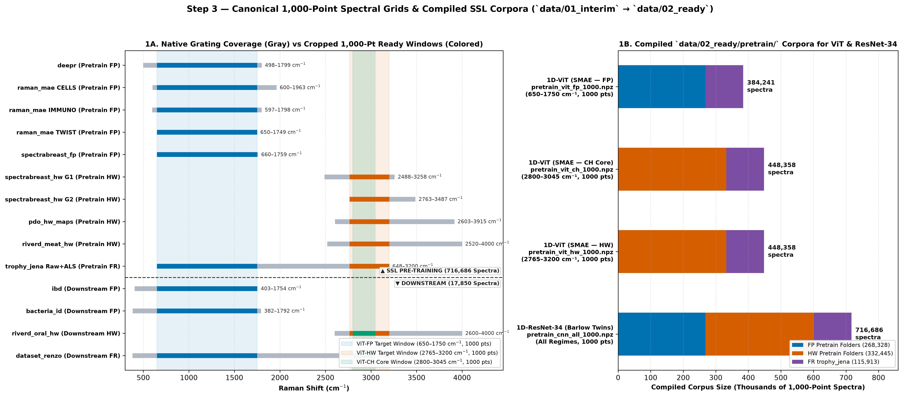
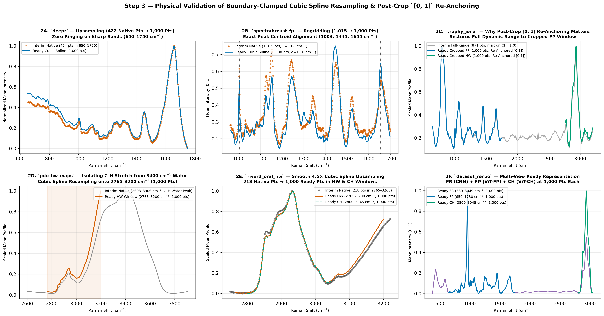
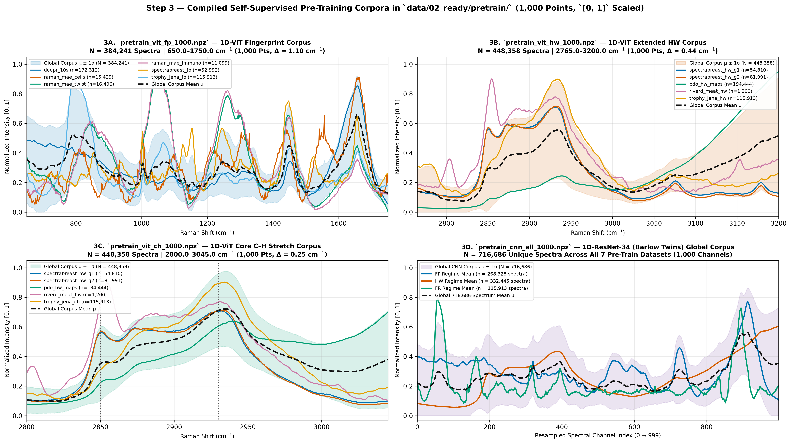
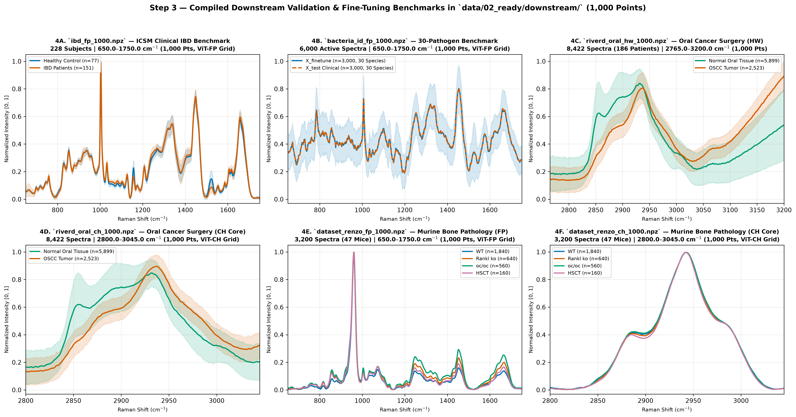

# Step 3 — Range Cropping, Cubic Spline Resampling (`1,000` Points) & Ready Corpora Compilation (`data/01_interim/` $\rightarrow$ `data/02_ready/`)

> [!IMPORTANT]
> **Architectural Separation Between Step 2 (`01_interim`) and Step 3 (`02_ready`)**
> - In **Step 2 (`data/01_interim/`)**, every dataset was physically cleaned (Whitaker-Hayes cosmic-ray despiking + regime-calibrated Asymmetric Least Squares baseline subtraction) and normalized to `[0, 1]` on its **native instrument grating** (`500` to `2,670` channels) without premature cropping or interpolation.
> - In **Step 3 (`data/02_ready/`)**, we map those physically clean native spectra onto **canonical `1,000`-point wavenumber grids** via **Boundary-Clamped Natural Cubic Spline Interpolation** followed by **Post-Crop `[0, 1]` Re-Anchoring**, assembling the unified corpora for **Self-Supervised Pre-Training (`1D-ViT SMAE` and `1D-ResNet-34 Barlow Twins`)** and the **4 Downstream Evaluation Benchmarks (`ibd`, `bacteria_id`, `riverd_oral_hw`, `dataset_renzo`)**.

---

## 1. Methodological Principles of Step 3

### 1.1 Why `1D-ViT (SMAE)` and `1D-ResNet-34 (Barlow Twins)` Require Distinct Ready Corpora
1. **Position-Locked Patch Tokenization in `1D-ViT (SMAE)`**:
   - A 1D Vision Transformer divides a `1,000`-point spectrum into fixed-size patches (e.g., `50` patches of `20` points) and adds learnable positional embeddings to each patch index $p \in \{1, \dots, P\}$.
   - Consequently, patch $p$ must always correspond to the **exact same physical vibrational band in $\text{cm}^{-1}$** across every pre-training and downstream spectrum. We therefore compile dedicated position-locked `1,000`-point corpora for each spectral window:
     - **Fingerprint (`ViT-FP`)**: **`650.00 – 1750.00` $\text{cm}^{-1}$** (`1,000` points, $\Delta\tilde{\nu} = 1.1011\text{ cm}^{-1}/\text{pt}$), pooling all 5 `pretrain/FP` sub-cohorts plus the `650–1750` $\text{cm}^{-1}$ Fingerprint window extracted from `trophy_jena` (**`384,241` spectra**).
     - **Extended High-Wavenumber (`ViT-HW`)**: **`2765.00 – 3200.00` $\text{cm}^{-1}$** (`1,000` points, $\Delta\tilde{\nu} = 0.4354\text{ cm}^{-1}/\text{pt}$), pooling all 4 `pretrain/HW` sub-cohorts (`spectrabreast_hw` Grating 1 & 2, `pdo_hw_maps`, `riverd_meat_hw`) plus the `2765–3200` $\text{cm}^{-1}$ HW window recovered from `trophy_jena Raw+ALS` (**`448,358` spectra**).
     - **Core $\text{C–H}$ Stretching (`ViT-CH`)**: **`2800.00 – 3045.00` $\text{cm}^{-1}$** (`1,000` points, $\Delta\tilde{\nu} = 0.2452\text{ cm}^{-1}/\text{pt}$, **`448,358` spectra**), specifically aligned with Full-Range datasets whose upper grating terminates at `~3049` $\text{cm}^{-1}$ (`dataset_renzo` `380–3049` $\text{cm}^{-1}$).
2. **Translation-Equivariant Feature Learning in `1D-ResNet-34 (Barlow Twins)`**:
   - A 1D Convolutional Neural Network uses shared convolutional kernels that slide across the `1,000`-channel axis, learning local peak morphologies (widths, shoulders, doublet splittings, and local curvatures) regardless of absolute position.
   - This allows `1D-ResNet-34 (Barlow Twins)` to be pre-trained on the **entire unified corpus (`pretrain_cnn_all_1000.npz`: `716,686` unique physical spectra across all 7 pre-training datasets — `268,328` `FP` + `332,445` `HW` + `115,913` `FR`)** resampled to `1,000` points.

### 1.2 Boundary-Clamped Natural Cubic Spline Interpolation (`1,000` Points)
Implemented in [`src/spectrabreast/preprocessing/resampling.py`](file:///c:/Users/alexf/Desktop/SPECTRA-BREAST/src/spectrabreast/preprocessing/resampling.py) (`resample_cubic_spline_batch`):
- **Why Natural Cubic Spline (`bc_type='natural'`)?** Unlike linear interpolation (which clips sharp Lorentzian/Voigt Raman peak apices when upsampling from `500` to `1,000` points), a $C^2$-continuous cubic spline preserves exact band centroids, peak curvature, and FWHM (`1003` $\text{cm}^{-1}$ Phenylalanine, `1445` $\text{cm}^{-1}$ $\text{CH}_2$, `1655` $\text{cm}^{-1}$ Amide I).
- **Why Boundary Clamping?** Evaluating an unguarded cubic polynomial even a few $\text{cm}^{-1}$ outside a grating's native support (for example, `650.0–660.2` $\text{cm}^{-1}$ on `spectrabreast_fp`, whose native grating begins at `660.22` $\text{cm}^{-1}$) causes cubic term $(x - x_0)^3$ runaway. Clamping evaluation coordinates to `[wn_src[0], wn_src[-1]]` ensures smooth, flat boundary continuation without edge blow-up.

### 1.3 Why Post-Crop `[0, 1]` Re-Anchoring is Physically Necessary
Re-anchoring each resampled `1,000`-point window to `[0.0000, 1.0000]` is **not** a redundant normalization of the same range, for two physical reasons:
1. **Sub-Window Dynamic Range Restoration**: In a Full-Range spectrum (`trophy_jena` `648.7–3200` $\text{cm}^{-1}$ or `dataset_renzo` `380–3049` $\text{cm}^{-1}$) or a broad High-Wavenumber spectrum (`pdo_hw_maps` `2603–3915` $\text{cm}^{-1}$), the global maximum (`1.0`) lies on the intense $\text{C–H}$ (`2930` $\text{cm}^{-1}$) or $\text{O–H}$ water (`3400` $\text{cm}^{-1}$) band, leaving the Fingerprint window (`650–1750` $\text{cm}^{-1}$) with a local maximum of only `~0.35–0.45`. Re-anchoring `[0, 1]` after cropping places the extracted `FP` or `HW` window on the exact same `[0, 1]` scale as native `FP`/`HW` datasets.
2. **Elimination of Cubic Spline Overshoot**: Between discrete sample points near `0.0` or `1.0`, a $C^2$ cubic polynomial can dip to `-0.002` or peak at `1.002`. Post-resampling Min-Max re-anchoring guarantees exact `[0.0000, 1.0000]` bounds for every spectrum in `data/02_ready/`.

---

## 2. Master Inventory of Compiled `data/02_ready/` Archives

The full machine-readable catalog is saved in [`docs/ready_datasets_catalog.csv`](file:///c:/Users/alexf/Desktop/SPECTRA-BREAST/docs/ready_datasets_catalog.csv):

| Role | Folder | Ready Archive (`.npz`) | Target Regime | Wavenumber Grid ($\text{cm}^{-1}$) | Points | Step ($\text{cm}^{-1}$) | Total Spectra | Constituent Cohorts | Value Range |
| :--- | :--- | :--- | :--- | :---: | :---: | :---: | :---: | :--- | :---: |
| **SSL Pre-Training (`ViT-SMAE`)** | `pretrain/FP` | `pretrain_vit_fp_1000.npz` | `FP` (Fingerprint) | `650.00–1750.00` | `1,000` | `1.1011` | **384,241** | `deepr` (`172,312`) + `raman_mae` (`43,024`) + `spectrabreast_fp` (`52,992`) + `trophy_jena_fp` (`115,913`) | `[0.0000, 1.0000]` |
| **SSL Denoising (`ViT / CNN`)** | `pretrain/FP` | `deepr_paired_fp_1000.npz` | `FP` (Paired `0.1s`/`1.0s`) | `650.00–1750.00` | `1,000` | `1.1011` | **172,312 pairs** | `deepr` paired `inputs_01s` (`172,312`) & `outputs_10s` (`172,312`) | `[0.0000, 1.0000]` |
| **SSL Pre-Training (`ViT-SMAE`)** | `pretrain/HW` | `pretrain_vit_hw_1000.npz` | `HW` (Extended HW) | `2765.00–3200.00` | `1,000` | `0.4354` | **448,358** | `spectrabreast_hw` (`136,801`) + `pdo_hw_maps` (`194,444`) + `riverd_meat_hw` (`1,200`) + `trophy_jena_hw` (`115,913`) | `[0.0000, 1.0000]` |
| **SSL Pre-Training (`ViT-SMAE`)** | `pretrain/CH` | `pretrain_vit_ch_1000.npz` | `CH` (Core $\text{C–H}$ Stretch) | `2800.00–3045.00` | `1,000` | `0.2452` | **448,358** | `spectrabreast_hw` (`136,801`) + `pdo_hw_maps` (`194,444`) + `riverd_meat_hw` (`1,200`) + `trophy_jena_ch` (`115,913`) | `[0.0000, 1.0000]` |
| **SSL Pre-Training (`Full-Range`)** | `pretrain/FR` | `trophy_jena_fr_1000.npz` | `FR` (`650–3200` $\text{cm}^{-1}$) | `650.00–3200.00` | `1,000` | `2.5526` | **115,913** | `trophy_jena` Raw+ALS Full-Range (`115,913` foreground pixels) | `[0.0000, 1.0000]` |
| **SSL Pre-Training (`1D-ResNet-34`)** | `pretrain/CNN` | `pretrain_cnn_all_1000.npz` | Multi-Regime (`FP+HW+FR`) | `1,000-ch index` | `1,000` | — | **716,686** | All 7 Pre-Train Datasets: `268,328 FP` + `332,445 HW` + `115,913 FR` | `[0.0000, 1.0000]` |
| **Downstream Benchmark (`FP`)** | `downstream/FP` | `ibd_fp_1000.npz` | `FP` (`ViT-FP` + Native `1000`) | `650.00–1750.00` | `1,000` | `1.1011` | **228** | ICSM Clinical IBD Plasma Cohort (`77` Healthy Control vs `151` IBD) | `[0.0000, 1.0000]` |
| **Downstream Benchmark (`FP`)** | `downstream/FP` | `bacteria_id_fp_1000.npz` | `FP` (`ViT-FP` + Native `1000`) | `650.00–1750.00` | `1,000` | `1.1011` | **6,000** | Bacteria-ID 30-Pathogen Benchmark (`3,000` `X_finetune` + `3,000` `X_test`) | `[0.0000, 1.0000]` |
| **Downstream Benchmark (`HW`)** | `downstream/HW` | `riverd_oral_hw_1000.npz` | `HW` (`ViT-HW` + Broad `1000`) | `2765.00–3200.00` | `1,000` | `0.4354` | **8,422** | RiverD Oral Cancer Surgery (`5,899` Normal vs `2,523` OSCC Tumor, `186` patients) | `[0.0000, 1.0000]` |
| **Downstream Benchmark (`CH`)** | `downstream/CH` | `riverd_oral_ch_1000.npz` | `CH` (`ViT-CH` Core) | `2800.00–3045.00` | `1,000` | `0.2452` | **8,422** | RiverD Oral Cancer Surgery (`2800–3045` $\text{cm}^{-1}$ Core $\text{C–H}$ view) | `[0.0000, 1.0000]` |
| **Downstream Benchmark (`FR/FP/CH`)** | `downstream/FR` | `dataset_renzo_fr_1000.npz` | `FR` + `FP` + `CH` (All 3 Views) | `380.00–3049.00` | `1,000` | `2.6717` | **3,200** | Murine Bone Cohort (`47` mice, `3,200` spectra: `WT`, `HSCT`, `oc-oc`, `Rankl-ko`) | `[0.0000, 1.0000]` |

---

## 3. Visual Audit & Methodological Verification (`docs/figures/03_ready_compilation/`)

### 3.1 Figure 1 — Canonical `1,000`-Point Spectral Grids & Corpus Routing Architecture

- **Panel 1A** illustrates how every dataset's native wavenumber span (gray bars) is cropped onto the shared physical windows:
  - **Blue (`650–1750` $\text{cm}^{-1}$)**: Feeds `pretrain_vit_fp_1000.npz` (`384,241` spectra) and downstream `ibd_fp_1000.npz`, `bacteria_id_fp_1000.npz`, and `dataset_renzo_fp_1000.npz`.
  - **Orange (`2765–3200` $\text{cm}^{-1}$)**: Feeds `pretrain_vit_hw_1000.npz` (`448,358` spectra) and downstream `riverd_oral_hw_1000.npz`.
  - **Green (`2800–3045` $\text{cm}^{-1}$)**: Feeds `pretrain_vit_ch_1000.npz` (`448,358` spectra) and downstream `riverd_oral_ch_1000.npz` + `dataset_renzo_ch_1000.npz`.
- **Panel 1B** shows the exact constituent breakdown of the four major pre-training archives, highlighting how `trophy_jena` (`115,913` full-range spectra) bridges the `FP` and `HW/CH` ViT corpora while contributing once to the `716,686`-spectrum `1D-ResNet-34 (Barlow Twins)` corpus.

---

### 3.2 Figure 2 — Physical Validation of Boundary-Clamped Cubic Spline Resampling

- **Panel 2A (`deepr`)**: Upsampling from `422` native points (inside `650–1750` $\text{cm}^{-1}$) to `1,000` points via Natural Cubic Spline traces the discrete native nodes smoothly without Gibbs ringing.
- **Panel 2B (`spectrabreast_fp`)**: Regridding from `1,015` native points ($\Delta\tilde{\nu} = 1.08\text{ cm}^{-1}$) to `1,000` points ($\Delta\tilde{\nu} = 1.10\text{ cm}^{-1}$) preserves the exact centroids of Phenylalanine (`1003` $\text{cm}^{-1}$), $\text{CH}_2$ scissoring (`1445` $\text{cm}^{-1}$), and Amide I (`1655` $\text{cm}^{-1}$).
- **Panel 2C (`trophy_jena`)**: Demonstrates why **post-crop `[0, 1]` re-anchoring** is critical when extracting sub-windows from Full-Range spectra: on the uncropped spectrum (gray), the `FP` region peaks at `~0.42` because the global maximum (`1.0`) is on the `2930` $\text{cm}^{-1}$ $\text{C–H}$ band; post-crop `[0, 1]` re-anchoring (blue) restores full dynamic range to `trophy_jena_fp`.
- **Panel 2D (`pdo_hw_maps`)**: Cropping `2765–3200` $\text{cm}^{-1}$ cleanly isolates the lipid/protein $\text{C–H}$ stretching envelope from the broad `3400` $\text{cm}^{-1}$ $\text{O–H}$ water band of aqueous organoid cultures.
- **Panel 2E (`riverd_oral_hw`) & Panel 2F (`dataset_renzo`)**: Confirm smooth cubic spline resampling across all multi-view downstream representations (`FR`, `FP`, `HW`, `CH`).

---

### 3.3 Figure 3 — Compiled Self-Supervised Pre-Training Corpora (`data/02_ready/pretrain/`)

- **Panel 3A (`pretrain_vit_fp_1000.npz`, $N = 384,241$)**: All 6 Fingerprint sources align on the shared `650–1750` $\text{cm}^{-1}$ grid, exhibiting coherent biological peaks at `785`, `1003`, `1128`, `1300`, `1445`, and `1655` $\text{cm}^{-1}$.
- **Panel 3B (`pretrain_vit_hw_1000.npz`, $N = 448,358$) & Panel 3C (`pretrain_vit_ch_1000.npz`, $N = 448,358$)**: All 5 High-Wavenumber sources align across the symmetric $\text{CH}_2$ (`2850` $\text{cm}^{-1}$), asymmetric $\text{CH}_2$ (`2885` $\text{cm}^{-1}$), $\text{CH}_3$ (`2930` $\text{cm}^{-1}$), and olefinic `=C–H` (`3010` $\text{cm}^{-1}$) bands.
- **Panel 3D (`pretrain_cnn_all_1000.npz`, $N = 716,686$)**: Combines all `268,328` `FP`, `332,445` `HW`, and `115,913` `FR` spectra into a single `1,000`-channel corpus for translation-equivariant `1D-ResNet-34 (Barlow Twins)` representation learning.

---

### 3.4 Figure 4 — Compiled Downstream Evaluation Benchmarks (`data/02_ready/downstream/`)

- **Panel 4A (`ibd_fp_1000.npz`, $N = 228$)**: Healthy Controls ($n=77$) vs IBD Patients ($n=151$) on the exact `ViT-FP` grid (`650–1750` $\text{cm}^{-1}$, `1,000` pts).
- **Panel 4B (`bacteria_id_fp_1000.npz`, $N = 6,000$)**: `X_finetune` ($n=3,000$) and `X_test` ($n=3,000$) across 30 pathogenic species on the exact `ViT-FP` grid.
- **Panel 4C (`riverd_oral_hw_1000.npz`, $N = 8,422$) & Panel 4D (`riverd_oral_ch_1000.npz`, $N = 8,422$)**: Normal Oral Tissue ($n=5,899$) vs Oral Squamous Cell Carcinoma ($n=2,523$) across `186` surgical resection patients, showing pronounced lipid-to-protein ($\text{CH}_2\text{ 2850} / \text{CH}_3\text{ 2930}$) shifts between healthy and malignant margins.
- **Panel 4E (`dataset_renzo_fp_1000.npz`, $N = 3,200$) & Panel 4F (`dataset_renzo_ch_1000.npz`, $N = 3,200$)**: Murine bone spectra stratified across the 4 genetic/therapeutic cohorts (`WT`, `HSCT`, `oc-oc`, `Rankl-ko`), capturing both the mineral phosphate/carbonate/collagen Fingerprint bands (`960`, `1070`, `1245`, `1450`, `1660` $\text{cm}^{-1}$) and the organic matrix $\text{C–H}$ stretching profile (`2850–2980` $\text{cm}^{-1}$).

---

## 4. Companion Modular Notebook
All steps, tables, and figures are reproducible cell-by-cell in [`notebooks/03_ready_datasets_compilation.ipynb`](file:///c:/Users/alexf/Desktop/SPECTRA-BREAST/notebooks/03_ready_datasets_compilation.ipynb), backed by [`src/spectrabreast/preprocessing/resampling.py`](file:///c:/Users/alexf/Desktop/SPECTRA-BREAST/src/spectrabreast/preprocessing/resampling.py) and [`src/spectrabreast/preprocessing/ready_atlas.py`](file:///c:/Users/alexf/Desktop/SPECTRA-BREAST/src/spectrabreast/preprocessing/ready_atlas.py).
