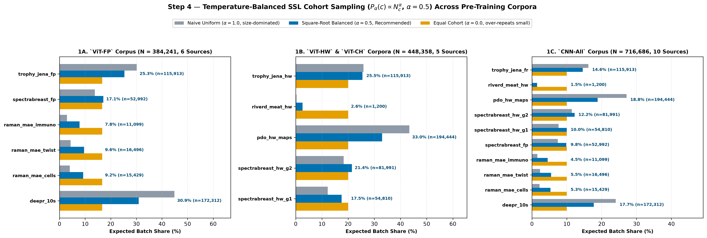
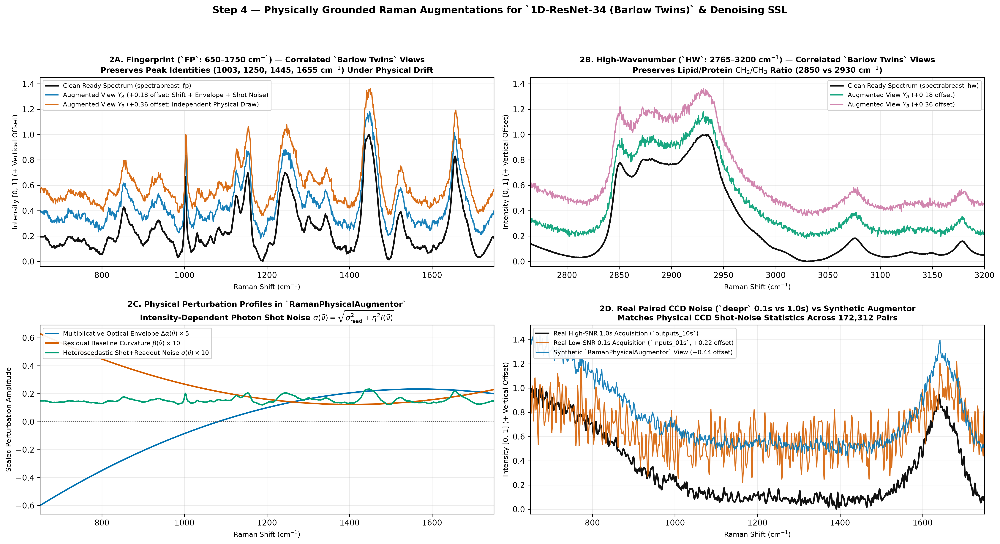
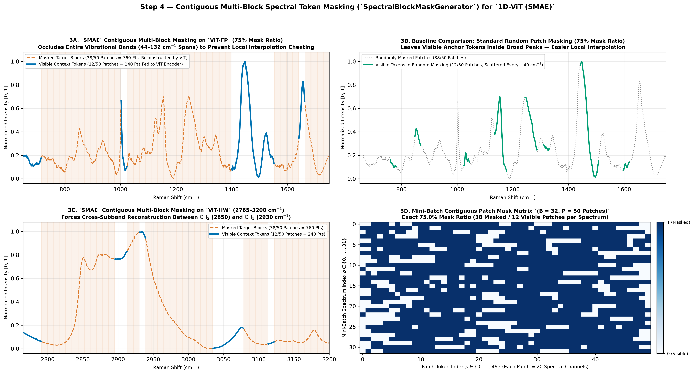
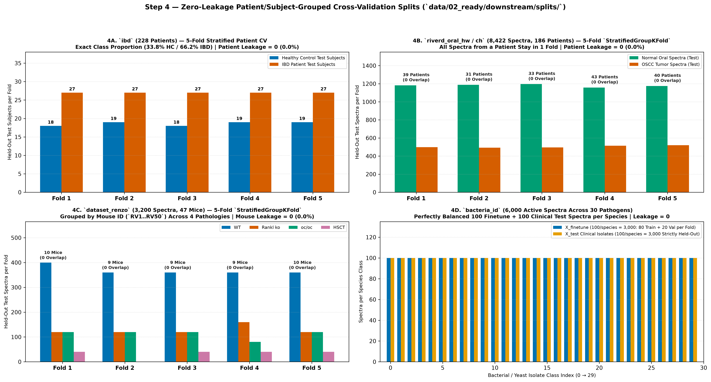

# Step 4 — Temperature-Balanced SSL DataLoaders, Physical Raman Augmentations, Contiguous Multi-Block Masking & Zero-Leakage Patient Splits (`src/spectrabreast/data/`)

> [!IMPORTANT]
> **Bridging `data/02_ready/` with Self-Supervised Pre-Training & Clinical Fine-Tuning**
> Step 4 (`src/spectrabreast/data/`) solves the four fundamental data-loading challenges of multi-cohort Raman foundation modeling:
> 1. **Cohort Size Imbalance ($1,200$ vs $194,444$ spectra)**: Addressed via **Square-Root Temperature-Balanced Sampling ($P_\alpha(c) \propto N_c^{0.5}$)**.
> 2. **Physical Invariance in Contrastive SSL (`1D-ResNet-34 Barlow Twins`)**: Addressed via **`RamanPhysicalAugmentor`**, which models sub-pixel grating drift, optical transmission envelopes, residual fluorescence curvature, and heteroscedastic Poisson-Gaussian CCD shot noise.
> 3. **Preventing Local-Interpolation Cheating in Masked Autoencoding (`1D-ViT SMAE`)**: Addressed via **`SpectralBlockMaskGenerator`**, which masks `75%` of patch tokens (`38/50` patches of `20` points) in **contiguous multi-patch blocks (`40–120` channels)** spanning full vibrational bands.
> 4. **Zero Patient/Subject Data Leakage in Downstream Validation**: Addressed via **`StratifiedGroupKFold(n_splits=5)`** grouped strictly by patient (`riverd_oral_hw`, `ibd`) or mouse (`dataset_renzo`), persisted in `data/02_ready/downstream/splits/`.

---

## 1. Temperature-Balanced SSL Cohort Sampling ($P_\alpha(c) \propto N_c^{\alpha}$)

Implemented in [`src/spectrabreast/data/splits.py`](file:///c:/Users/alexf/Desktop/SPECTRA-BREAST/src/spectrabreast/data/splits.py) (`compute_temperature_sampling_weights`) and [`src/spectrabreast/data/datasets.py`](file:///c:/Users/alexf/Desktop/SPECTRA-BREAST/src/spectrabreast/data/datasets.py) (`SSLPretrainDataset`):

$$\quad P_{\alpha}(c) = \frac{N_c^{\alpha}}{\sum_{k=1}^{K} N_k^{\alpha}}, \qquad w_i = \frac{P_{\alpha}(c_i)}{N_{c_i}}, \qquad \alpha = 0.5$$

- Under **Naive Uniform Sampling ($\alpha = 1.0$)**, `deepr` ($44.8\%$) and `trophy_jena` ($30.2\%$) dominate `ViT-FP`, while `raman_mae_immuno` receives only $2.9\%$ of batch updates; in `ViT-HW`, `riverd_meat_hw` ($1,200$ spectra) receives only $0.27\%$ of updates.
- Under **Equal Cohort Sampling ($\alpha = 0.0$)**, `riverd_meat_hw` is over-sampled $162\times$ relative to `pdo_hw_maps`, causing rapid memorization of its $1,200$ spectra.
- Under **Square-Root Temperature Balancing ($\alpha = 0.5$, Recommended Default)**, underrepresented biological cohorts (`raman_mae` cell/immune lines, `spectrabreast_fp`, `riverd_meat_hw`) receive a balanced $4\text{–}17\%$ batch share without memorization.

---

## 2. Physically Grounded Raman Augmentations for `1D-ResNet-34 (Barlow Twins)`

Implemented in [`src/spectrabreast/data/augmentations.py`](file:///c:/Users/alexf/Desktop/SPECTRA-BREAST/src/spectrabreast/data/augmentations.py) (`RamanPhysicalAugmentor`):

Given a clean `1,000`-point spectrum $x(\tilde{\nu}) \in [0, 1]$, `generate_barlow_twins_views` draws two independent physical views $(Y_A, Y_B)$ by composing four realistic instrumental perturbations followed by `[0, 1]` re-anchoring:
1. **Sub-Pixel Wavenumber Calibration Drift** ($\Delta\tilde{\nu} \sim \mathcal{U}[-1.8, +1.8]$ channels, $p = 0.85$): Models slight monochromator thermal drift and laser wavelength tolerance across spectrometers without altering relative inter-peak distances.
2. **Multiplicative Chromatic / Etalon Envelope** ($\alpha(\tilde{\nu}) = 1 + a_1 P_1(\tilde{\nu}) + a_2 P_2(\tilde{\nu}) \in [0.88, 1.12]$, $p = 0.80$): Models smooth variations in objective lens transmission and CCD quantum efficiency across the spectral window.
3. **Residual Fluorescence / Baseline Curvature Perturbation** ($\beta(\tilde{\nu}) = c_0 + b_1 P_1(\tilde{\nu}) + b_2 P_2(\tilde{\nu})$, $|b_k| \le 0.035$, $p = 0.75$): Enforces representation invariance against minor residual background curvature after ALS subtraction.
4. **Heteroscedastic Poisson-Gaussian CCD Shot + Readout Noise** ($p = 0.90$):
   $$\epsilon(\tilde{\nu}) \sim \mathcal{N}\!\left(0,\; \sigma_{\text{read}}^2 + \eta^2 \max(x(\tilde{\nu}), 0)\right), \qquad \sigma_{\text{read}} = 0.012,\; \eta = 0.020$$
   Unlike unrealistic uniform Gaussian noise, photon-counting shot noise scales with $\sqrt{I(\tilde{\nu})}$, matching the empirical noise distribution observed in the `172,312` real paired `0.1s` vs `1.0s` acquisitions of `deepr_paired_fp_1000.npz`.

---

## 3. Contiguous Multi-Block Spectral Masking for `1D-ViT (SMAE)`

Implemented in [`src/spectrabreast/data/augmentations.py`](file:///c:/Users/alexf/Desktop/SPECTRA-BREAST/src/spectrabreast/data/augmentations.py) (`SpectralBlockMaskGenerator`):

- Each `1,000`-point spectrum is partitioned into $P = 50$ patches of $L_p = 20$ channels (`22.0` $\text{cm}^{-1}$ per patch in `FP`, `8.7` $\text{cm}^{-1}$ in `HW`, `4.9` $\text{cm}^{-1}$ in `CH`).
- At a **75% mask ratio (`38` masked patches, `12` visible context patches)**, standard random single-patch masking leaves visible patches scattered every $\sim 40\text{ cm}^{-1}$, allowing a decoder to interpolate broad bands (`Amide I`, `C–H stretch`) locally.
- **Contiguous Multi-Block Masking (`mode='block'`)** groups the `38` masked patches into contiguous blocks of `2` to `6` patches (`40` to `120` contiguous channels = `44–132` $\text{cm}^{-1}$ in `FP`), completely removing entire vibrational bands and forcing the `1D-ViT` encoder to infer masked regions from biochemically coupled bands elsewhere in the spectrum (e.g., reconstructing `Amide I` at `1655` $\text{cm}^{-1}$ from `Amide III` at `1250` $\text{cm}^{-1}$ and `Phenylalanine` at `1003` $\text{cm}^{-1}$).

---

## 4. Zero-Leakage Patient/Subject-Grouped Cross-Validation Splits (`data/02_ready/downstream/splits/`)

Implemented in [`src/spectrabreast/data/splits.py`](file:///c:/Users/alexf/Desktop/SPECTRA-BREAST/src/spectrabreast/data/splits.py) (`build_and_verify_downstream_splits`) and [`src/spectrabreast/data/datasets.py`](file:///c:/Users/alexf/Desktop/SPECTRA-BREAST/src/spectrabreast/data/datasets.py) (`DownstreamFoldLoader`), with full fold metrics exported to [`docs/downstream_splits_catalog.csv`](file:///c:/Users/alexf/Desktop/SPECTRA-BREAST/docs/downstream_splits_catalog.csv):

| Benchmark | Ready Regime(s) | Split Archive in `downstream/splits/` | Grouping / Protocol | Train Spectra / Fold | Test Spectra / Fold | Train Subjects | Test Subjects | Subject Overlap Leakage |
| :--- | :--- | :--- | :--- | :---: | :---: | :---: | :---: | :---: |
| **`ibd`** | `FP` (`650–1750` + Native `1000`) | `ibd_5fold_splits.npz` | 5-Fold `StratifiedKFold` (by `patient_id`) | `182–183` | `45–46` | `182–183` patients | `45–46` patients | **`0` (`0.00%`)** |
| **`bacteria_id`** | `FP` (`650–1750` + Native `1000`) | `bacteria_id_splits.npz` | Official Split: `X_finetune` (5-Fold Val) + Held-Out Clinical `X_test` | `2,400` (+`600` Val) | `3,000` (Clinical Test) | `30` species | `30` species | **`0` (`0.00%`)** |
| **`riverd_oral_hw / ch`** | `HW` (`2765–3200`), `CH` (`2800–3045`), Broad | `riverd_oral_5fold_grouped_splits.npz` | 5-Fold `StratifiedGroupKFold` (grouped by surgical patient `sample_id`) | `6,625–6,845` | `1,577–1,797` | `148–149` patients | `37–38` patients | **`0` (`0.00%`)** |
| **`dataset_renzo`** | `FR` (`380–3049`), `FP` (`650–1750`), `CH` (`2800–3045`) | `dataset_renzo_5fold_grouped_splits.npz` | 5-Fold `StratifiedGroupKFold` (grouped by mouse `sample_id` `RV1..RV50`) | `2,520–2,600` | `600–680` | `37–38` mice | `9–10` mice | **`0` (`0.00%`)** |

---

## 5. Companion Modular Notebook
All data loaders, augmentations, block-mask generators, and zero-leakage split audits are interactive and reproducible cell-by-cell (`3–12` lines per cell) in [`notebooks/04_dataloaders_and_augmentations.ipynb`](file:///c:/Users/alexf/Desktop/SPECTRA-BREAST/notebooks/04_dataloaders_and_augmentations.ipynb).
